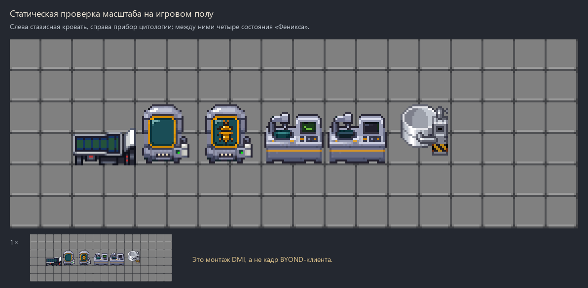
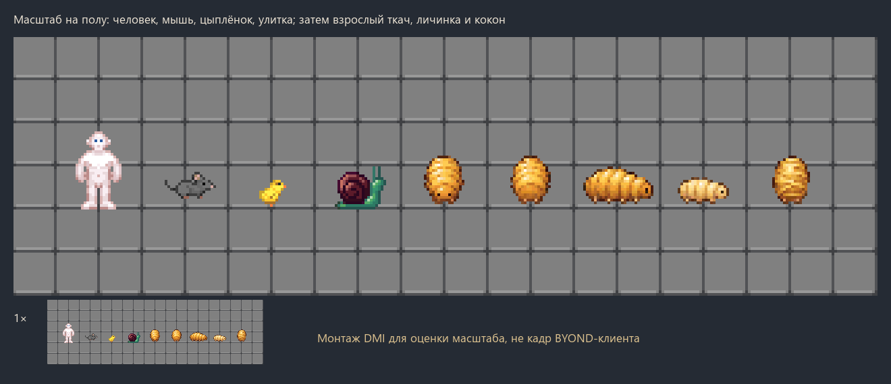
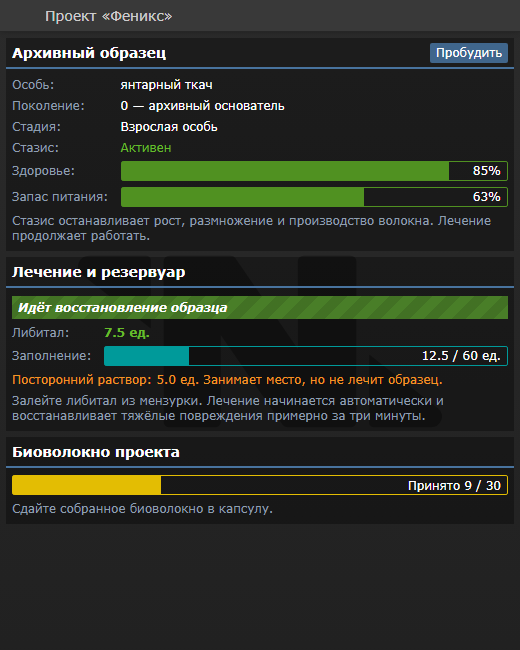
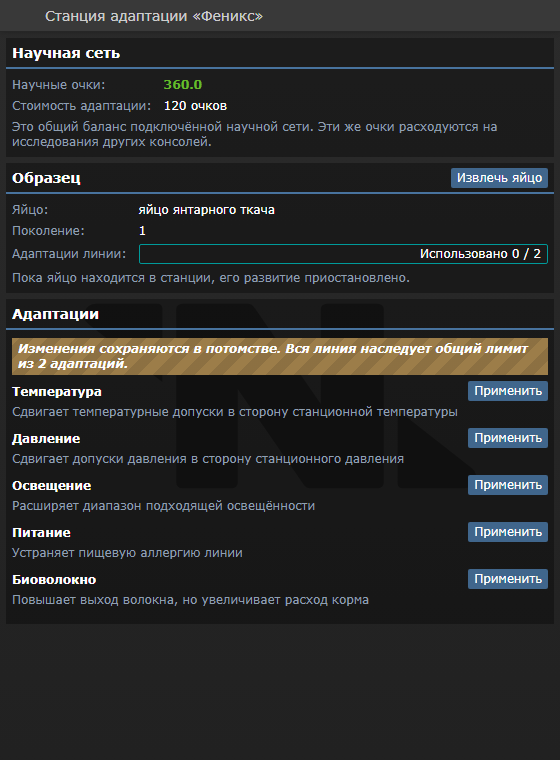

# Проект «Феникс»

Цель смены: восстановить промышленное разведение янтарного ткача, вырастить три здоровых взрослых потомка и сдать 30 единиц биоволокна.

## Игровой цикл

1. Объявление цели открывает в карго заказ оборудования проекта. Первый выполненный заказ содержит архивную капсулу с основателем, станцию адаптации, три вида физического субстрата, анализатор и пробу овощного корма. Следующие заказы содержат запасное оборудование с пустой капсулой. Повторное объявление не выдаёт нового основателя.
2. Подготовьте замкнутый атмосферный отсек до 144 клеток. Уложите субстрат из упаковки на соседний пол; убрать его можно лопатой. Полезная площадь делится между животными. Открытая дверь может соединить отсек с остальной станцией.
3. Откройте панель капсулы: она показывает образец, стазис, здоровье, питание и текущее состояние лечения. Пробудите образец кнопкой «Пробудить». Медицинский анализатор показывает состояние особи и качественные признаки стресса: ниже/выше безопасного или репродуктивного диапазона. Численные измерения среды выполняются атмосферными приборами; сканер здоровья не показывает их или таблицу скрытых допусков. Изменяйте условия по одному и сравнивайте реакцию особи.
4. Кормите съедобными предметами с выключенным боевым режимом. Успешное кормление расходует предмет, сопровождается короткой анимацией и сообщением «накормлен». При полном запасе ткач отвечает «сыт» и не расходует еду; в стазисе и коконе кормление недоступно. Аллергия относится к одной из групп пищи; овощной корм остаётся доступным во всех стартовых профилях. Запас питания расходуется только при активной биологии.
5. В подходящих условиях основатель откладывает яйцо. Оно проходит инкубацию, личинку и кокон. Эта версия вида партеногенетическая: для начала проекта достаточно одной архивной особи.
6. Возьмите яйцо в руку и кликните им по станции адаптации с выключенным боевым режимом. В панели станции выберите изменение, затем извлеките яйцо обратно в руку или на пол. Нужны питание и исследовательский доступ. Внутри станции яйцо приостановлено и не развивается. Стоимость — **120 общих научных очков** за изменение; обе адаптации линии стоят 240. Панель показывает актуальный баланс, цену, использованный лимит и причины недоступности изменений. Вся линия наследует расход лимита из двух адаптаций. Температура/давление немного сдвигаются к станционным значениям, световой диапазон расширяется, аллергия может быть снята, выход волокна повышается до 1.5 базового ценой большего расхода корма. Грунт и дыхательная специализация сохраняются.
7. Волокно собирается с пола и сдаётся в капсулу. Засчитывается только материал этого проекта, физически потреблённый при приёмке. Для завершения также нужны три здоровых взрослых естественных потомка, сытых и находящихся в репродуктивной среде.

Стазис сохраняет особь, но останавливает питание, рост, размножение и выпуск волокна. Внешнее лечение капсулой продолжает работать. Произвольный ящик не заменяет вольер и не изолирует от внешней опасной атмосферы. Максимум популяции проекта — 12 животных и яиц.

## Применение биоволокна

Карго закупает биоволокно по базовой цене **150 кредитов за единицу**, без снижения цены после продажи партий. Штатные временные бонусы экспорта сохраняются. Сданные в капсулу единицы физически расходуются, поэтому продать тот же материал нельзя; излишек остаётся у станции.

В меню изготовления, раздел **Chemistry**, доступны **гемостатические биоповязки**: 2 единицы волокна и 5 единиц стерилизина дают 6 применений. Они используют обычную механику марли, вдвое быстрее снижают кровотечение и выдерживают вдвое больший объём пропитывания. Поддержка ожогов и переломов остаётся на уровне обычной марли; прямого восстановления повреждений нет. Сырьё и реагент расходуются при изготовлении.

## Лечение

Подведите живого повреждённого ткача к пустой капсуле, откройте её панель и нажмите «Сохранить» у нужной особи. Налейте в капсулу **либитал (Libital)** из мензурки. Также доступны обычные переносы шприцем. Резервуар вмещает 60 единиц раствора. Лечение начинается автоматически; открытая TGUI-панель обновляет здоровье, количество либитала, общую заполненность и статус лечения при доливе и расходовании. Посторонние растворы учитываются отдельно и не отображаются как либитал.

Тяжёлая травма восстанавливается примерно за три минуты; небольшие повреждения — быстрее. Расход: примерно одна единица либитала на четыре единицы здоровья, то есть около 10 единиц на полный запас здоровья ткача. Без лекарства лечение приостанавливается; прочие растворы его не заменяют. Здоровый, погибший или выпущенный ткач не расходует лекарство. Капсула не оживляет погибших. Пассивного восстановления здоровья снаружи больше нет; обычные медицинские пакеты на ткача не действуют и не расходуются.

После добавления цели нажмите `Announce` в `Debug → Modify Goals`, затем закажите «Оборудование проекта «Феникс»» в научном разделе карго. Само объявление ничего не доставляет. Отменённый заказ не расходует единственный архивный образец. Обычный спавн капсулы или комплекта через Game Panel не создаёт основателя и не расходует право на первый настоящий заказ.

## Начальные параметры

Профиль cold/warm/dim выбирается один раз; внутри него генерируются связанные вариации условий. Яйца получают независимую точную копию текущей родительской линии. Изменение яйца не меняет взрослого родителя.

Все периоды — начальные балансные значения: яйцо 90 с, личинка 120 с, кокон 60 с, откладка 180 с, выпуск волокна 60 с. Начальный запас питания — 30, максимальный — 100. Основатель выпускает 0.2 обычного объёма; дробный остаток сохраняется. Голодание и опасная среда наносят постепенный урон, а теснота, свет и грунт подавляют воспроизводство. Уложенный субстрат снимается лопатой и возвращается в упаковку; подсказка есть у покрытий и у их упаковок.

## Научные очки

Станция адаптации расходует баланс подключённой techweb, общий с консолью R&D. На обычной консоли после разблокировки он виден в строке **Gen. Res.**; та же величина отображается в панели «Феникса» и меняется при исследованиях других консолей. Базовые уровни цен исследований в этой базе — 40/80/120/160/200, пассивный доход работающей научной сети — 1 очко в секунду. Цена адаптации 120 соответствует третьему уровню этой шкалы; две адаптации требуют четырёх минут пассивного дохода. Скидки за эксперименты могут уменьшать цену обычных исследований.

## Диапазоны условий

Температура, общее давление и парциальные давления O₂/CO₂ имеют безопасный диапазон и более узкий диапазон для размножения. Обе границы включаются. В безопасном диапазоне за пределами репродуктивного особь живёт, но не размножается; за безопасными границами получает постепенный урон. Плохое освещение, теснота и неподходящий грунт мешают воспроизводству, но сами по себе не наносят экологический урон.

Например, базовый профиль `dim` до случайных сдвигов допускает 60–150 кПа для жизни и 85–115 кПа для размножения. При 125 кПа он сможет жить, а размножение остановится. Конкретная линия наследует свои сгенерированные границы; диагностика указывает направление нужной коррекции, не раскрывая их таблицу.

Кислород оценивается по парциальному давлению, а не по проценту смеси: `P(O₂) = P(общее) × доля O₂`. При общем давлении 100 кПа доля 0,1% даёт всего 0,1 кПа O₂ — этого недостаточно любому исходному профилю. Небольшое изменение с 21% до 21,1% не означает автоматического выхода из диапазона.

## Проверка вручную

- Пройти через взрослого ткача, личинку и кокон с четырёх сторон: проходимость должна сохраниться, стоящий человек должен рисоваться поверх ткача. Проверить боковые и передний/задний ракурсы в реальном освещении клиента; статический монтаж DMI этого не заменяет.
- Оценить волокно экспортным сканером и продать две партии: без временного бонуса цена 150 за единицу сохраняется. Изготовить биоповязки из 2 волокна и 5 ед. стерилизина, проверить расход сырья и применение к порезу; оставленный для цели материал не должен исчезать сверх принятого количества.
- Капсула с основателем должна показывать янтарный образец за стеклом. После пробуждения, внешнего перемещения или удаления образца окно становится пустым; повторное сохранение возвращает образец на спрайт. У станции адаптации при отключении питания гаснут экран и подсветка рабочей чашки; при восстановлении включаются.
- Объявить цель штатным управлением station goals: ничего не должно доставляться автоматически, заказ должен появиться в карго. Первый выполненный заказ должен содержать основателя в стазисе, второй — пустую капсулу. Повторное объявление не сбрасывает этот лимит.
- Осмотреть занятую капсулу: описание состояния должно появляться без runtime. На пустой панели проверить список соседних особей и отсутствие кнопки пробуждения; после сохранения — живые данные выбранного образца и кнопку «Пробудить». Удалённый/перемещённый кандидат не должен сохраняться через устаревшее окно; сменившийся образец не должен выпускаться устаревшим запросом.
- Повредить живого ткача и вернуть в стазис. Без либитала здоровье не растёт; после загрузки через мензурку оно постепенно восстанавливается с расходом лекарства. Не закрывая панель, проверить изменение запаса при доливе/расходе и здоровья при лечении. Вода увеличивает общую заполненность, но не количество либитала. Проверить паузу при исчерпании лекарства, отсутствие расхода после выздоровления и остановку при выпуске; погибшая особь не оживает.
- До пробуждения подготовить небольшой герметичный вольер, доступ к воздуху/температуре/свету и покрытие.
- По качественным подсказкам анализатора добиться отсутствия экологических нарушений, покормить и проследить реальную цепочку яйцо → личинка → кокон → взрослый потомок. Сканер не должен выводить численные температуру, давление, газы, освещение, площадь или тип покрытия вокруг ткача.
- Поднять яйцо обычным кликом, загрузить кликом из руки в станцию. Проверить один физический слот и приостановку развития, извлечение, внешний перенос и удаление станции без потери яйца или оставшегося стазиса. Изменить яйцо за 120 очков, сравнить потомка с родителем; проверить наследование лимита и отказ третьей адаптации без списания. Открытая панель должна показывать изменение общего баланса при расходе на другой консоли.
- Открыть дверь, увеличить население, сменить свет/рацион: проверить остановку воспроизводства и диагностические признаки. Стазис не должен производить ресурсы.
- Сдать чужую и подходящую партии. Только вторую принять с расходом предмета; повторный ввод не увеличивает зачёт. Партия без популяции не завершает цель.
- В открытом TGUI отойти, извлечь или заменить яйцо, снять доступ или питание: устаревшие действия не должны менять линию и расходовать очки. Повтор одного запроса с прежним счётчиком адаптаций не должен списывать второй платёж.

## Графика

Капсула и станция адаптации используют собственный `icons/phoenix_equipment.dmi`: четыре статических кадра 32×32, прозрачность только 0/255, без сглаживания и дизеринга. Общая палитра — **64 непрозрачных цвета плюс прозрачность**. Пустая капсула использует 38 цветов, занятая — 48, включённая станция — 33, выключенная — 28. Палитра общая, поэтому количества по кадрам не суммируются. Оттенки металла, стекла, янтарного образца и индикаторов сохранены отдельно.

Состояния: `capsule_empty`, `capsule_occupied`, `adaptation_on`, `adaptation_off`. Корпус внутри каждой пары совпадает пиксель в пиксель. Занятость капсулы и работоспособность станции переключают состояния автоматически. Происхождение и лицензия описаны в [icons/ATTRIBUTION.md](icons/ATTRIBUTION.md).

Сам ткач использует `icons/phoenix_weaver.dmi`: отдельные изображения взрослой особи, личинки, кокона и погибшей особи каждой стадии. Все кадры 32×32, alpha только 0/255, общая палитра — 64 непрозрачных цвета плюс прозрачность. Подвижные стадии имеют четыре направления; кокон — одно. Ракурсы используют принятую для станции проекцию: видимый бок и брюшко в профиль, укороченные передний и задний виды, без поворота фронтального изображения на 90°. Масштабирование и одноцветное окрашивание тараканьего изображения удалены. Ткач проходимый и рисуется на низком слое мобов, под проходящими людьми. Смерть и оживление используют стандартные hooks basic mob и сохраняют внешний вид текущей стадии.

## Превью

Монтажи DMI показывают масштаб и состояния объектов, а не кадр BYOND-клиента.

Интерфейсы сняты с собранного TGUI с тестовыми данными; серверные действия проверяются отдельно в DM.

## Ограничения первой версии

Для яйца, волокна и субстрата используются существующие изображения. Фигура за стеклом капсулы — схематическое изображение сохранённого образца. Капсула и станция адаптации используют собственные обновляемые TGUI-панели. Спрайты ткача пока статические, без анимации ползания. Полный растительный симбионт из раннего концепта не включён; ботаника участвует рационом. Значения требуют проверки темпа и баланса в игровом раунде.
