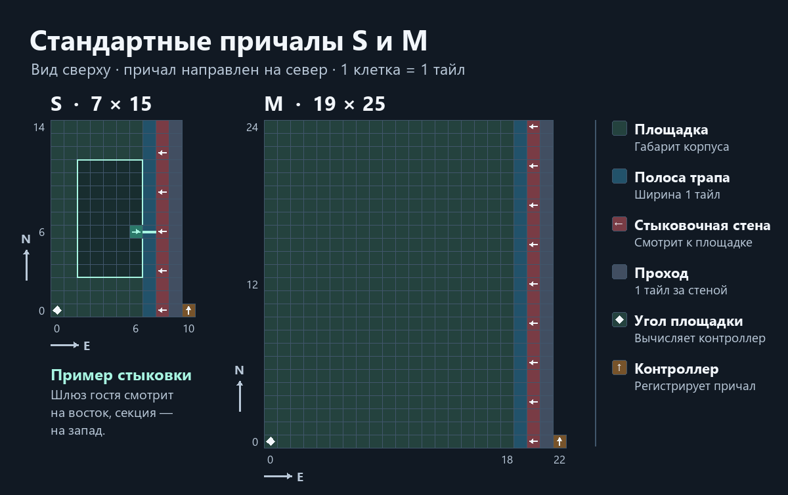
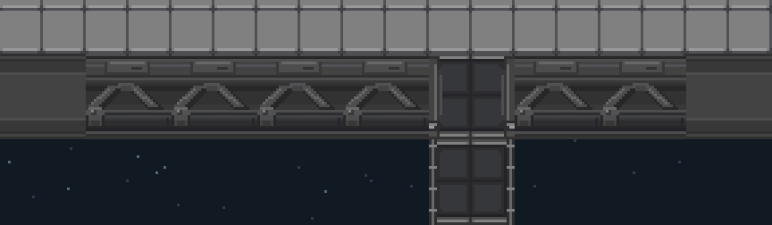
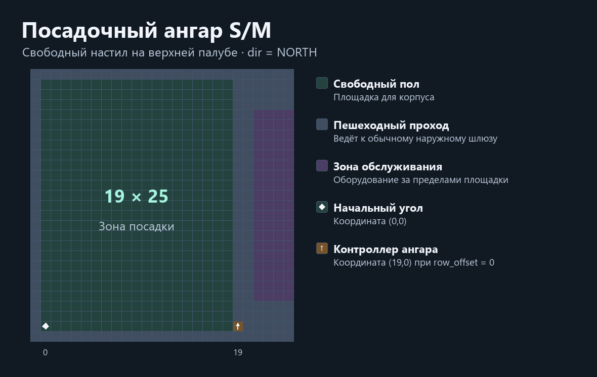

# Доки и ангары для кораблей overmap

В редакторе TGM расставьте площадку, инфраструктуру и контроллер. На контроллере готовой площадки задайте уникальный в секторе `site_id` и видимое имя `dock_name`. При загрузке сектора или носителя контроллер автоматически регистрирует причал с этим ID. Невидимый порт для переноса корабля создаётся в игре.

| Что строите | Контроллер | Свободная площадка |
| --- | --- | --- |
| Стыковочный док S | `/obj/machinery/computer/stationtrauma_dock_controller` | 7×15 |
| Стыковочный док M | `/obj/machinery/computer/stationtrauma_dock_controller/medium` | 19×25 |
| Посадочный ангар для S и M | `/obj/machinery/computer/stationtrauma_dock_controller/hangar` | 19×25 на верхней палубе |

В доках корабль соединяется с секцией стены герметичным трапом. В ангаре корабль садится на настил, экипаж выходит через обычный наружный шлюз. Для построенного в раунде контроллера используйте **«Показать площадку» → «Проверить площадку» → «Зарегистрировать причал»**.

## Стыковочный док S/M

Для `dir = NORTH` локальный угол `(0,0)` лежит на юго-западе площадки. Координаты в таблице отсчитываются от него.

| Элемент | S | M |
| --- | --- | --- |
| Корпус | `x=0..6, y=0..14` | `x=0..18, y=0..24` |
| Полоса трапа | `x=7, y=0..14` | `x=19, y=0..24` |
| Секции стены | `x=8, y=0..14` | `x=20, y=0..24` |
| Проход за стеной | `x=9, y=0..14` | `x=21, y=0..24` |
| Контроллер | `(10,0)` | `(22,0)` |

Секции `/obj/machinery/door/airlock/stationtrauma_docking/wall` должны смотреть на площадку. При ориентации контроллера на север секции смотрят на запад. При повороте всей схемы поворачивайте и секции. Полоса трапа и корпус занимают свободные тайлы космоса или пола. Уберите с них оборудование, контейнеры и предметы.

Если нужное место для контроллера дальше по стене, сдвиньте его вдоль собственного `dir` и запишите число клеток сдвига в `row_offset`. Например, при `row_offset = 10` на северном S-доке контроллер стоит в `(10,10)`. Начальный угол площадки остаётся `(0,0)`.

Поставьте на краю гостевого корабля `/obj/machinery/door/airlock/stationtrauma_docking/ship` на пол, лицом наружу. Оставьте свободный пол за шлюзом и свободную клетку перед ним. После причаливания его шлюз смотрит на одну из секций стены, а трап проходит по прямой между ними. Подведите питание и воздух к обоим отсекам. Без запаса давления двери могут остаться закрытыми даже при развёрнутом трапе.

## Посадочный ангар S/M

1. На верхней связанной палубе разметьте **19×25** тайлов свободного пола. Поставьте склад, инструменты и места ожидания за границей площадки. Для обозначений используйте напольные декали.
2. Для `dir = NORTH` поставьте контроллер ангара в `(19,0)`, прямо у восточного края. Если сдвигаете его вдоль края, укажите `row_offset`. Задайте `site_id` и `dock_name` для готового ангара.
3. Оставьте проходимый настил от границы площадки к коридору и от обычного шлюза корабля до маршрута экипажа. На носителе пол и контроллер относятся к собственным областям корпуса.
4. Проверьте взлёт после посадки. Освободившийся настил должен восстановить покрытие и декали.

## Примеры в редакторе

| Площадка | Контроллер и геометрия исходной карты |
| --- | --- |
| Грузовой S, `cyberiad_cargo_s_dock` | [Cyberiad Overmap](../../_maps/map_files/CyberiadOvermap/CyberiadOvermap.dmm). Контроллер `(69,118,1)`, `NORTH`, `row_offset = 10`. Угол `(59,108,1)`. |
| Станционный M, `cyberiad_m_dock` | [Cyberiad Overmap](../../_maps/map_files/CyberiadOvermap/CyberiadOvermap.dmm). Контроллер `(49,121,2)`, `WEST`. Угол `(49,99,2)`. |
| Общий причал, `cyberiad` | [Cyberiad Overmap](../../_maps/map_files/CyberiadOvermap/CyberiadOvermap.dmm). Контроллер `/station` в `(218,136,2)` задаёт точку `(222,132,2)`. Его `site_id` совпадает с `station_id` профиля карты. |
| M на носителе, `trurl_m1` | [«Трурль»](../../_maps/map_files/overmap_ships/trurl.dmm). Контроллер `(87,110,1)`, `SOUTH`. Угол `(109,110,1)`. |

При загрузке шаблона координаты и Z могут сместиться. Для стартового гостя задайте на его mobile-порту `starting_dock`, равный `site_id` контроллера. На носителе принадлежность причала определяет область под контроллером. [Причалы носителей](CARRIERS.md)

## Приёмка

- Прогоните [maplint](../../tools/maplint/README.md) и проверьте `dir`, `row_offset`, питание и проходы.
- На готовой карте проверьте наличие причала в ЦУП до действий экипажа. Для ручной установки отдельно проверьте разметку и регистрацию.
- Проверьте швартовку, открытие обоих шлюзов и выход через трап. В ангаре проверьте посадку, путь от обычного шлюза и взлёт.
- На носителе проверьте стартового гостя и сохранение причала при движении. На аванпосте проверьте автоматическое разрешение и положение точки на карте сектора.
