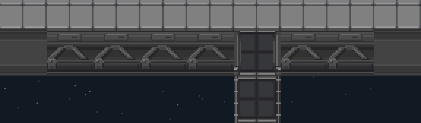
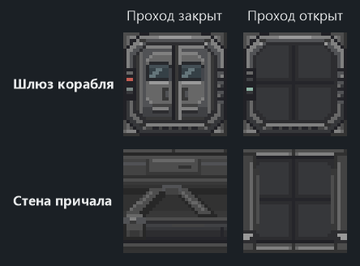

# Чек-лист мапперского корабля overmap

Проверять фактическую карту вместе с текущим DM-кодом. Поле `ship_class` не заменяет геометрию, наличие машин не доказывает их питание или работу. Ниже разделены условия регистрации, стыковки и оснащение автономного судна.

## Корпус и класс

- [ ] Один `/obj/docking_port/mobile/stationtrauma_space`, уникальный `shuttle_id`; старого обычного mobile-порта нет.
- [ ] При создании варианта из существующего шаттла его рабочие door/button IDs также уникальны: пульт нового корабля не управляет старым экземпляром.
- [ ] `area_type` указывает на собственный корень `/area/shuttle/stationtrauma_space/<ship>`. Все перевозимые клетки, оборудование и наружная обшивка принадлежат ему или подтипам.
- [ ] Внутренние отсеки разделены на осмысленные areas. Наружные площадки и сопла не объявлены герметичными помещениями; для них `monitored_compartment = FALSE`, при необходимости `vacuum_by_design`.
- [ ] S/M имеет одну палубу. Многопалубный template становится orbital-only capital и не годится для стандартной физической стыковки/посадки.
- [ ] Для **M**: `ship_class = "medium"`, фактический bbox вместе с соплами помещается в **19×25** с допустимым поворотом. Для S — 7×15. Размер проверяется по реальному hull, а не названию карты.
- [ ] Native `width/height/dwidth/dheight/dir` охватывают корпус; единственный mobile находится внутри допустимой сетки от `(1,1,1)`.

Источники: [loader](code/orbital_ship_loading.dm), [регистрация](code/sector.dm), [размеры](code/standard_dock.dm), [константы](../space_overmap/_space_overmap.dm), [контроль отсеков](../space_combat/code/compartments.dm).

## Стандартный причал и посадка

- [ ] Минимум один `/obj/machinery/door/airlock/stationtrauma_docking/ship`; `dir` направлен наружу. Обычный external airlock этот endpoint не заменяет.
- [ ] Hatch стоит на полу в docking layer корабля; клетка за ним — свободный пол собственного отсека. Перед ним — свободное пространство вне собственных areas.
- [ ] Есть реальный проход от hatch к экипажу и герметичная граница. Мебель, машины, окна и плотные объекты не перекрывают внутреннюю клетку/путь.
- [ ] Для выхода после посадки сохранён обычный наружный шлюз. Dedicated docking hatch открывается только через действующий gangway и не заменяет наземный выход.
- [ ] Питание и давление позволяют открыть трап; его наличие не создаёт воздух. После отстыковки корабль герметичен.
- [ ] Проверено именно открытие обоих endpoints, а не только появление пола трапа. У принимающего отсека достаточно воздуха: маленькая невентилируемая камера может потерять давление при заполнении прохода и попасть под штатную блокировку выравнивания.
- [ ] Если нужен старт у носителя, `starting_dock` совпадает с его `site_id`, класс и размеры совместимы. `starts_docked` в профиле не перезаписывает выбранный причал общим станционным.

Источники: [подбор hatch/площадки](code/standard_dock.dm), [шлюзы, трап и давление](code/standard_dock_gangway.dm), [носители](CARRIERS.md).

### Направления и M-причал Cyberiad Overmap

Секции стены образуют металлический отбойник. Его наружная кромка обращена к площадке. Направление `dir` корабельного шлюза указывает от корпуса к причалу. Осмотр секции или шлюза показывает направление в раунде.

Корабельный шлюз узнаётся по двум створкам со смотровым окном. Как у обычного шлюза, его створки всегда расходятся влево и вправо при любом направлении стыковки.

После исследования **«Строительство шаттлов»** инженерный или научный протолат печатает монтажные комплекты. Для ремонта восстановите пол и примените **монтажный комплект секции стыковочной стены** к прежней клетке. Комплект выставит направление по разметке. При следующей стыковке док найдёт секцию автоматически. Для корабельного шлюза и при строительстве стены без разметки ставьте комплект со стороны герметичного помещения.

Чтобы построить причал, выберите на контроллере нужного класса **«Показать площадку»**. Зелёным отмечено место для корпуса, синим — полоса трапа, красным — линия стены. Подведите питание и воздух, выберите **«Проверить площадку»**, устраните замечания и нажмите **«Зарегистрировать причал»**.

В `_maps/map_files/CyberiadOvermap/CyberiadOvermap.dmm`, исходный Z=2:

| Элемент | Координаты / направление |
| --- | --- |
| Контроллер M | `(49,121,2)`, `WEST`, имя площадки «Кибериада: M» |
| 25 секций стены | `x25..49, y119`, каждая `SOUTH` |
| Вычисляемый anchor | `(49,99,2)`, `WEST` |
| Площадка корпуса 19×25 | `x25..49, y99..117` |
| Полоса трапа | `x25..49, y118`, свободный космос |
| Проход за стеной | `x25..49, y120` |

Контроллер ставится в двух клетках за крайней секцией стены и направлен вдоль неё, а секции — поперёк, к площадке. Его меню **«Проверить площадку» → «Зарегистрировать причал»** публикует штатный runtime-причал в навигации сектора. Стена, коридор и скопированный западный тамбур принадлежат питаемой area `entry`; контроллеру и секциям нужно её действующее питание.

### Ангарная площадка S/M

- Подготовьте свободный пол 19×25 на верхнем уровне связанной группы палуб. Если у станции или носителя одна палуба, она считается верхней.
- Оставьте доступ к площадке по полу и пользуйтесь обычными наружными шлюзами корабля. Для ангара достаточно площадки. Герметичный трап здесь не разворачивается.
- После исследования **«Строительство шаттлов»** изготовьте плату контроллера ангара. Соберите и запитайте контроллер рядом с краем площадки, поверните его по разметке и выберите **«Проверить площадку» → «Зарегистрировать причал»**. Площадка станет доступна через ЦУП.
- На карте можно сразу поставить `/obj/docking_port/stationary/stationtrauma_space_station/standard/hangar`. Укажите уникальный `site_id` и видимое `station_name`. Маркер ставится в углу площадки. При `dir = NORTH` её 19 клеток идут от него на восток, 25 на север, считая клетку маркера. Для ангара носителя также укажите `host_ship_id`.

## Управление, движение и переходы

- [ ] Helm `/obj/machinery/computer/stationtrauma_space_navigation` внутри собственного hull. Старые shuttle-console/camera-docker не используются как управление overmap.
- [ ] Исправные собранные engines зарегистрированы на корабле; после включения есть тяга и торможение. Для обычных propulsion топливные трубы не требуются.
- [ ] Для plasma/tritium engines реально собраны их heater/converter, питание, правильный газ/слой труб и свободный выхлоп. Один новый typepath сопла работоспособности не даёт.
- [ ] Для межсекторных рейсов есть `/obj/machinery/stationtrauma_bluespace_drive` с ненулевым `charges` и `/obj/machinery/computer/stationtrauma_bluespace`. Привод исправен, запитан и находится внутри hull.
- [ ] Учтён запас переходов: обычное ядро даёт 2, ёмкость привода 4. Начальный заряд задаётся осознанно.
- [ ] Сенсоры доступны через helm и navigation. Отдельной обязательной sensor machine нет.

Construction ship core нужен построенному игроками корпусу; заранее подготовленному template он не требуется. Fusion reactor, afterburner, ЦУП носителя и его dock controller не являются обязательным оснащением M-гостя.

Источники: [helm](code/console.dm), [тяга](code/navigation.dm), [двигатели](code/propulsion.dm), [bluespace](code/bluespace.dm), [терминалы](code/terminals.dm), [постройка](code/ship_core.dm).

## Автономное оснащение

- [ ] **Электрика:** интерьеры осознанно имеют `requires_power = TRUE`; у каждого powered area есть APC, а у APC — реально подключённый node cable.
- [ ] Генерация, запас энергии и распределение соединены правильно. SMES имеет входной terminal с нужным направлением и выходную сеть; вход/выход не закорочены одной сеткой.
- [ ] Начальный заряд, топливо, закрепление и режим генератора определены. Обычный PACMAN по умолчанию пуст, выключен и не закреплён.
- [ ] Доступны запас топлива, ремонтные инструменты, кабели и материалы. Отказ питания действительно влияет на оборудование, а бесплатная наружная area не маскирует blackout.
- [ ] **Атмос:** внутренние помещения стартуют с пригодной атмосферой; supply и scrubber/discharge — разные правильные сети. Vent/scrubber ориентированы, запитаны и физически подключены.
- [ ] Есть резерв дыхательной смеси и место для отходящих газов; переносной oxygen dispenser не выдается за жизнеобеспечение. Air alarms/датчики соответствуют areas.
- [ ] Источник подключён при загрузке. Переносной canister рядом с connector не подключается сам; у stationary tank проверены открытый порт и направление. Пустой сборник не заполнен газом, соседние stationary tanks не сливают запас и отходы.
- [ ] **Идентификация:** транспондер имеет `callsign` и `registration_faction` на своей circuitboard. Одних varedit на console недостаточно; исправная консоль закреплена, включена и запитана.
- [ ] **Связь:** ship all-in-one telecomms и пригодные для экипажа радио/гарнитуры; holopad по роли.
- [ ] **Доступ:** экипаж может попасть к helm, приводу, генерации, APC и аварийному выходу. Политика доступа согласована с ролью/фракцией судна.
- [ ] **Экипаж:** сиденья/ремни, медпомощь, огнетушитель, EVA/аварийный O₂ и ремонтный запас соответствуют назначению. Проходы и обслуживание оборудования доступны.

Это требования к полноценному автономному судну. Loader допускает unmetered areas без генератора, однако такой обход не доказывает готовую электрику.

Источники: [power contract](code/docking_port.dm), [транспондер/платы](code/transponder.dm), [связь](code/comms.dm), [питание на примере Pocket Rocket](../overmap_ships/code/pocketrocket.dm).

## Загрузка и приёмка

- [ ] DM definitions включены в действующую `.dme`-цепочку; карта доступна loader/lazy menu или явно добавлена в нужный fleet.
- [ ] Нет двойной загрузки через старый `roundstart_template` и overmap fleet. Старые `argos_home`/`argos_trurl` не выдаются за `site_id` стандартного M-причала.
- [ ] Maplint и статические bounds/type/area проверки проходят; просмотрены общий вид, помещения, power/atmos/areas и diff.
- [ ] Штатная сборка проходит. Успех compile не объявляется игровым тестом.
- [ ] В игре проверены загрузка одного экземпляра, доступ, питание, воздух, тяга/торможение, связь/транспондер, scan, M docking/отстыковка, обычный выход после посадки, bluespace и возвращение.
- [ ] Отдельно проверены blackout/восстановление, закрытие всех наружных шлюзов и доступность ремонта. Сохраняется оборудование и правильная принадлежность areas после переноса.

Существующие регрессии: `overmap_standard_dock`, `overmap_carrier`, `overmap_power`, `overmap_docking`, `overmap_passage`, `overmap_surface_dock`, `overmap_ship_docking` в `code/modules/unit_tests/`. Проверка конкретного оснащённого судна дополняет общую механику; статический PNG не исполняет `Initialize()`.
